# STMS Guide

**isotms.ru**

The system covers attendance, check-ups, self-tests, tests, on-track status, and detentions.

## Contents

1. [Navigation](#navigation)
2. [Admin Dashboard](#admin-dashboard)
3. [Supervisors' Dashboard](#supervisors-dashboard)
4. [Student's Info](#students-info)
5. [Goal Check](#goal-check)
6. [Attendance](#attendance)
7. [Traits](#traits)
8. [Oral and Book Reports](#oral-and-book-reports)
9. [Academic Projection](#academic-projection)
10. [Honor Roll](#honor-roll)
11. [Statistics](#statistics)
12. [Special Certificates](#special-certificates)

---

## Navigation

The main menu gives access to the Dashboard, Students, Goal Check Report, Certificates, Setup, Reports and Statistics. Use the **Role** selector at the bottom to switch between roles (for example, Supervisor).

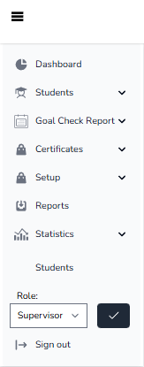

**Students** menu: Student List, Attendance, Traits, Oral Reports, Book Reports, Academic Projection, Honor Roll.

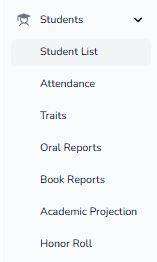

**Goal Check Report** menu: Student List, Demerits, Bible, Pages, Privilege, Detentions, Demerits and Detentions (new).

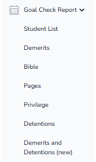

---

## Admin Dashboard

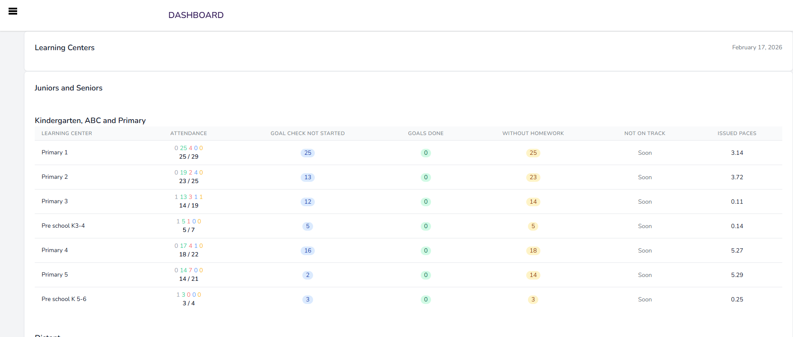

Each row is a learning center (LC). Click a group name to hide or show the whole section.

### Attendance

The Attendance column shows five numbers:

| # | Color | Meaning |
|---|---|---|
| 1 | – | Blank cells in the attendance chart |
| 2 | green | Present students who are not tardy |
| 3 | red | Students who are not present |
| 4 | blue | Present students who are tardy |
| 5 | orange | Students who are not present with a legitimate reason (mostly ill) |

Below them: the 1st number is the number of students currently present in the LC, the 2nd is the number of students assigned to the LC.

### Goal Check Not Started

The number of students who have an empty "Set" cell.

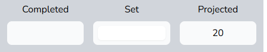

### Goals Done

The number of students with a green dot.

### Without Homework

Students who haven't set HW at the current moment. Should be 0, but can't exceed *Students Present − Goals Done*.

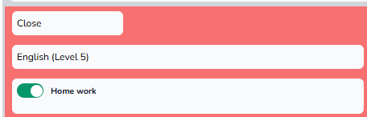

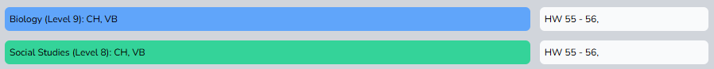

### Not On Track and Issued PACEs

- **Not On Track**: the number of students who are not On Track.
- **Issued PACEs**: the arithmetic mean of PACEs with the status ISSUED.

### Lists behind the numbers

Click on a number to show the list of students counted in it.

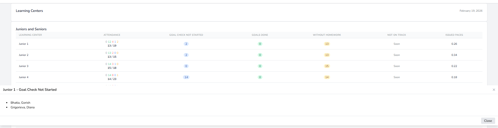

---

## Supervisors' Dashboard

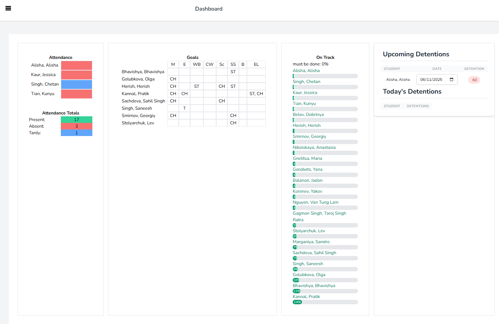

- **Attendance**: students who are absent, tardy, or ill. In other words, anyone who isn't present or blank.
- **Goals**: quickly check who has CH, ST or T.
- **On Track**: the list of all students. Green means on track, red means not. You can see what percentage of their HR should be completed up to this date.
- **Detentions**: two lists.
  - *Upcoming Detentions* (upper box): choose the date for the student to serve the detention.
  - *Today's Detentions* (lower box): students who need to serve their detentions today. Click and choose *completed*, *not completed*, or *cancel*.

---

## Student's Info

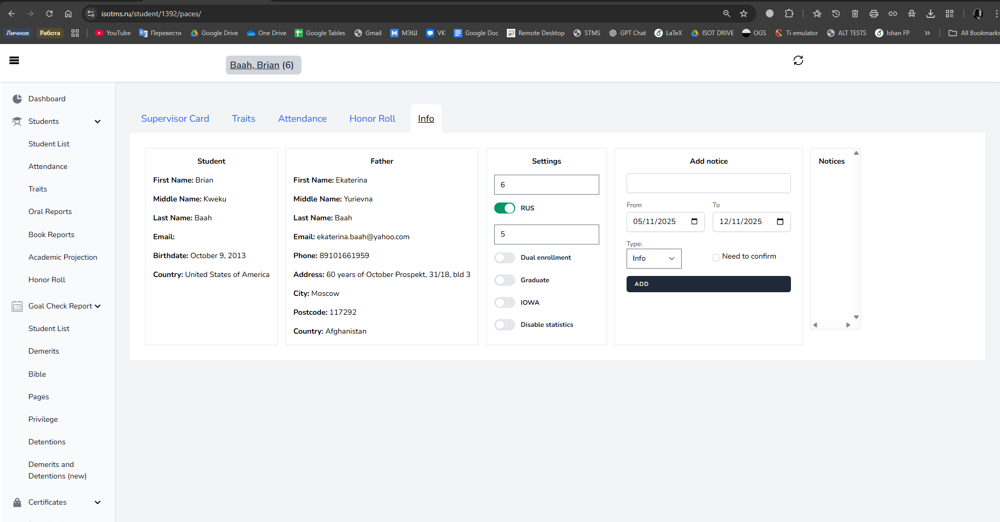

- **Student / Parents**: information about the student and the student's parents.
- **Required level according to age**: leave blank if no changes are needed.
- **RUS**: if the student is part of the Russian Program, move the slider to the right and enter the number of the student's Russian level.
- **Dual enrollment**: turn the slider on if the student is part of Dual Enrollment.
- **Graduate**: turn the slider on if the student graduates this year.
- **IOWA**: if the student participates in IOWA testing, enter the level the student will be tested on.
- **Disable statistics**: turn on if the student should not be counted in end-of-year statistics.
- **Add notice**: click **ADD** to leave a comment for the parent. The note is active through the dates in **From** and **To**. Check **Need to confirm** if you want a confirmation from a parent.

---

## Goal Check

### Student List

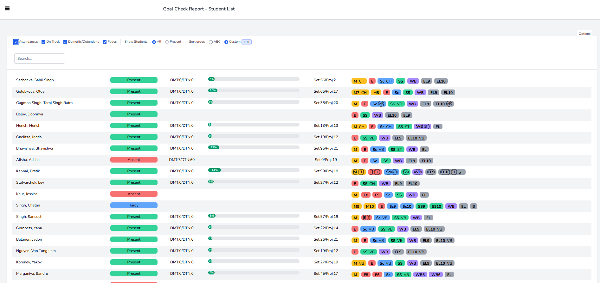

Click **Options** to see all the options for the goal check:

- **Attendance, On Track, Demerits, Pages**: turn on/off to show or hide.
- **Show Students → All**: shows all students, even if they are not present.
- **Show Students → Present**: shows only students who are neither absent nor ill.
- **Sort order → ABC**: alphabetical order.
- **Sort order → Custom**: your own order. Click **Edit** to set it.

### Custom Order

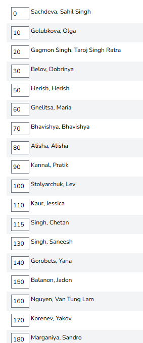

Students are listed in ascending order. Use multiples of 10: it makes it easier to insert additional students into the existing sequence.

### Student Tab

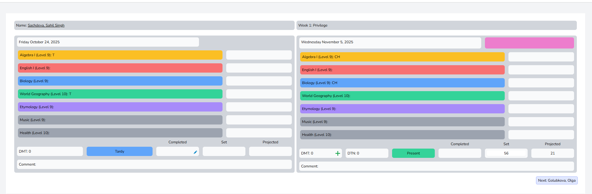

- **Date button**: choose the date of the day; applicable only for the previous day (left side).
- **Privilege for the week**
- **DMT**: general demerits not related to the subject.
- **Comment**: general comments.
- **Set**: enter the total number of pages for today. Test pages, labs, wisdom pages and separate papers students do are not counted.
- **Next**: go to the next student according to the order.

Hover over the number of set pages to see who entered it:

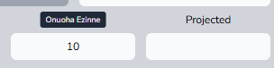

### Subject Tab

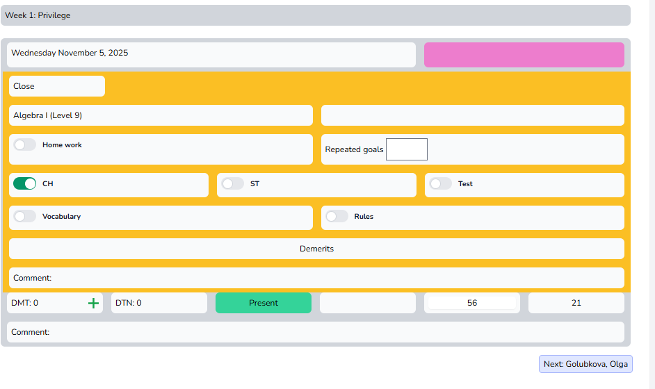

- **Home work**: slider on if the student has HW at the end of the day.
- **Repeated goals**: the number of days the goal is repeated: 1 for the first day, 2 for the second day the goal appears in the Goal Card.
- **CH, ST, Test, Vocabulary, Rules**: mark if there are any CH, ST, T, VB, or Rules to do.
- **Demerits**: choose any demerit related to the subject.
- **Comment**: for any comment related to the subject, click the **Comment:** button.

To find out whether a goal is repeated, check on the left side whether the HW is finished and click either **Done** or **Not Done**.

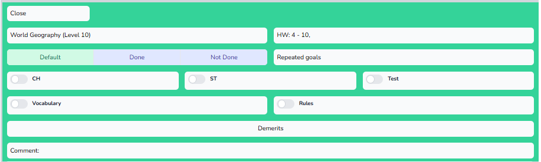

---

## Attendance

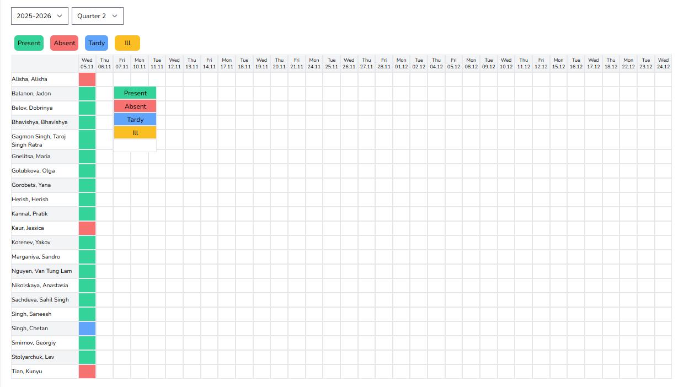

Choose whether the student is present, absent, tardy, or ill. The student won't be shown in the Goal Check unless you select **Present**.

> Only green and blank boxes count toward **Perfect Attendance**.

---

## Traits

1. Click on the student's name.

   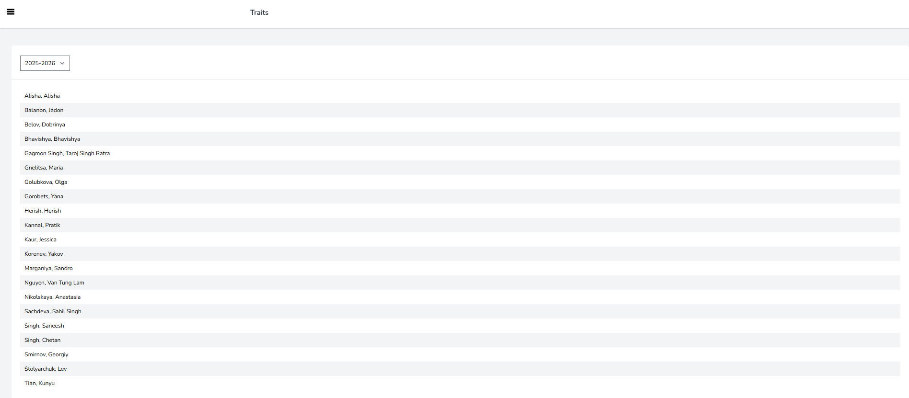

2. Click on the blank space and enter the grade for the student's trait.

   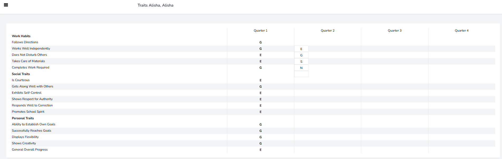

---

## Oral and Book Reports

As soon as the student completes the oral or book report, enter the date of completion in the related tab.

**Oral Reports**

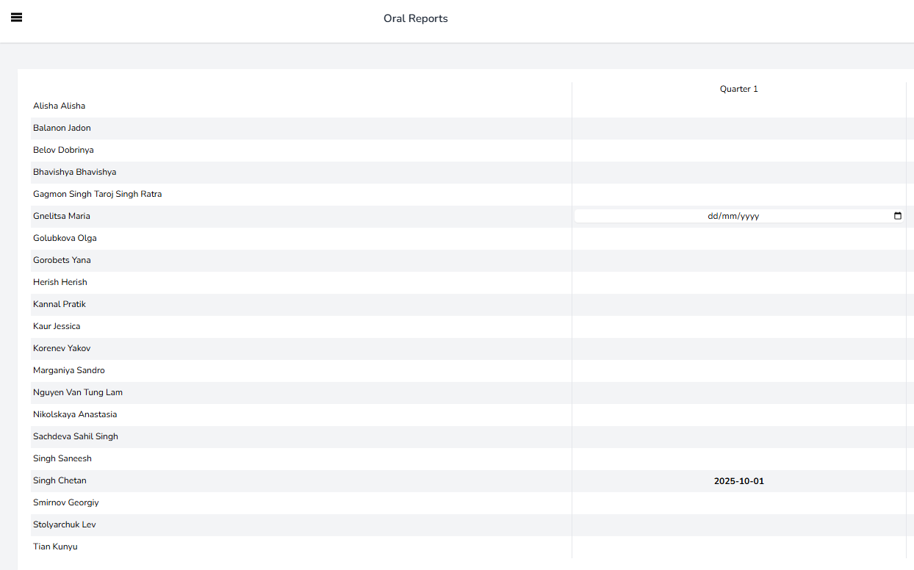

**Book Reports**

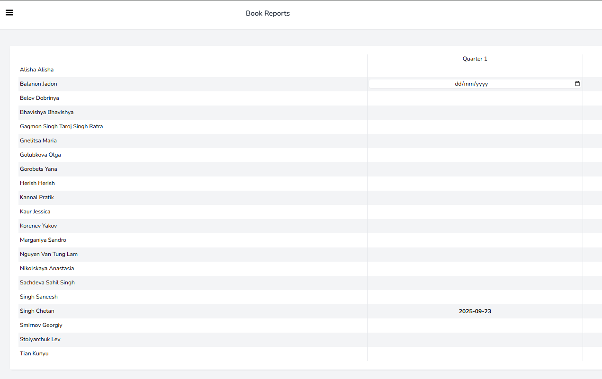

---

## Academic Projection

Click on the student's name to change the student's projection.

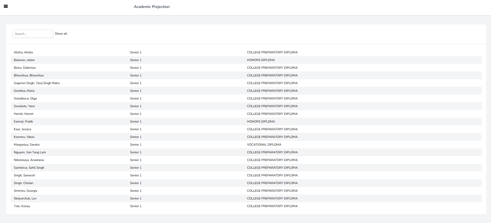

### Student Tab

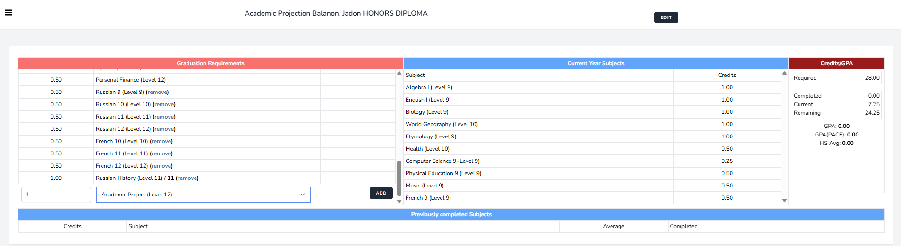

- **Current Year Subjects**: the list of subjects the student currently has.
- **Previously completed Subjects**: the list of previously completed subjects.
- **Credits**: click on the box to edit the default credit.
- **Add subjects**: enter the needed subjects into the projection. If the credit differs from the default, change it.

---

## Honor Roll

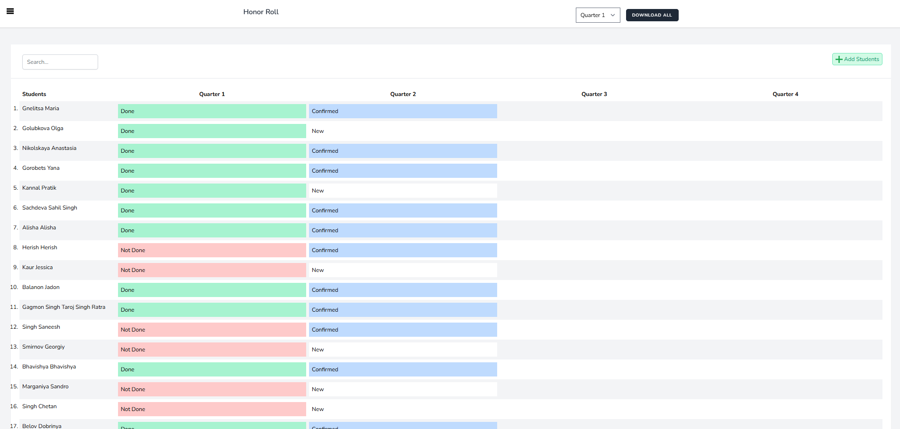

| Status | Meaning |
|---|---|
| **Done** | All required HR entries have scores. |
| **Not Done** | Not all required HR entries have scores. |
| **New** | Supervisor just entered the HR entries; an administrator must confirm them. |
| **Confirmed** | HR has been confirmed by an administrator. |

### Student tab

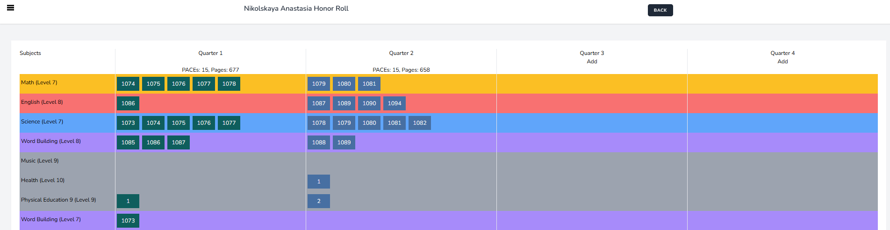

Each PACE has a certain number of pages assigned to it. The pool of pages for the HR is the sum of all pages.

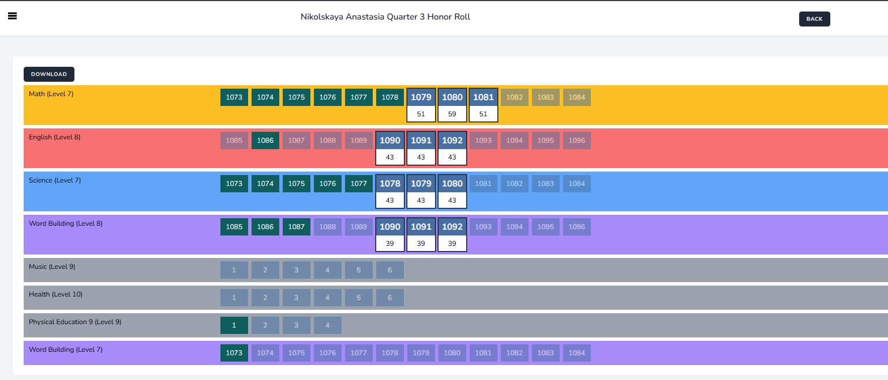

If the student has a PACE from a previous quarter, either change the number of pages, or have him start the PACE from the first page in his goal card and record it in the goal check.

---

## Statistics

Here you can check all the important information about your students: how many PACEs they have completed, their average score, whether they are on level, and more.

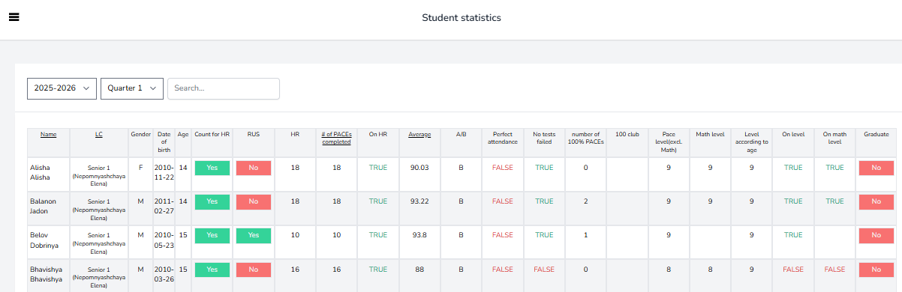

---

## Special Certificates

To issue a special certificate to a student, select the **Special Certificate** tab and enter the reason for the certificate.

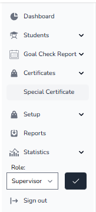

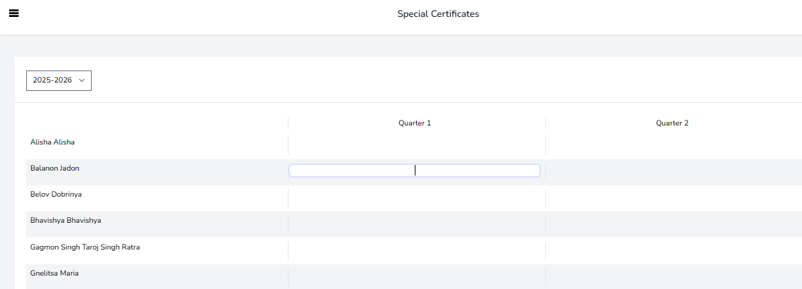
