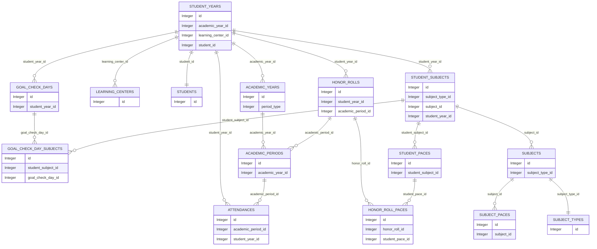

## Таблицы
записи created_at and updated_at несут технический характер 
### academic_periods
| Имя | Тип | Описание |
|-------|-------|-------|
| id | Integer | id строки в данной таблице |
| name | String | название четверти |
| start_date | Date | начало четверти |
| finish_date | Date | конец четверти |
| academic_year_id | Integer | id года в таблице academic_years |
| created_at | Date and time | дата создания записи |
| updated_at | Date and time | дата последнего обновления |

### academic_years
| Имя | Тип | Описание |
|-------|-------|-------|
| id | Integer | id строки в данной таблице |
| name | String | имя года в формате nnnn/nnnn |
| start_date | Date | начало года |
| finish_date | Date | конец года |
| period_type | Integer | семестр/триместр/четверти |
| created_at | Date and time | дата создания записи |
| updated_at | Date and time | дата последнего обновления |
| status | Integer | не используется |

### attendances
| Имя | Тип | Описание |
|-------|-------|-------|
| id | Integer | id строки в данной таблице |
| value | String | Present — 1, Absent — 2, Tardy — 3, Ill — 4, пятое состояние — это отсутствие записей по данному числу |
| date | Date | дата дня |
| academic_period_id | Integer | id из таблицы academic_period |
| student_year_id | Integer | id из таблицы student_year |
| created_at | Date and time | дата создания записи |
| updated_at | Date and time | дата последнего обновления |

### goal_check_day_subjects
| Имя | Тип | Описание |
|-------|-------|-------|
| id | Integer | id строки в данной таблице |
| home_work | Integer | нету — 0, есть — 1, выполнено — 2 |
| reapeated_goals | Integer | число дней которые ученик повторяет цель для предмета |
| checkout | Integer | нету — 0, есть — 1, выполнено — 2 |
| selftest | Integer | нету — 0, есть — 1, выполнено — 2 |
| test | Integer | нету — 0, есть — 1, выполнено — 2 |
| vocabulary | Integer | нету — 0, есть — 1, выполнено — 2 |
| rules | Integer | нету — 0, есть — 1, выполнено — 2 |
| comment | String | строка, в которую помещается коммент |
| student_subject_id | Integer | id из таблицы student_subject |
| goal_check_day_id | Integer | id из таблицы goal_check_day |
| created_at | Date and time | дата создания записи |
| updated_at | Date and time | дата последнего обновления |
| status | Integer | статус предмета для зелёной точки 0 - нет для зеленой точки, 1 - есть для зеленой точки|

### goal_check_days
| Имя | Тип | Описание |
|-------|-------|-------|
| detention_comment | String | текст коммента для detention |
| comment | String | текст коммента |
| id | Integer | id строки в данной таблице |
| demerit | Integer | общее кол‑во за день |
| demerit_confirmed | Integer | ???? |
| attendance | Integer | думал перенести сюда, но потом оставил отдельной таблицей |
| detention_completed | Integer |  |
| student_year_id | Integer | id из таблицы student_year |
| completed_pages | Integer | количество законченных страниц |
| set_pages | Integer | количество страниц, которые мы ставим на день |
| projected_pages | Integer | количество страниц, которые бы надо сделать |
| status | Integer | 1 -есть зеленая точка, 0 - нет зеленой точки|
| set_pages_user_id | Integer | id пользователя из таблицы user |
| created_at | Date and time | дата создания записи |
| updated_at | Date and time | дата последнего обновления |
| date | Date | Дата, к которой относится запись |
| detention_date | Date | Дата в которую студент должен исполнить detention  |

### learning_centers
| Имя | Тип | Описание |
|-------|-------|-------|
| id | Integer | id строки в данной таблице |
| name | String | Название LC (Junior 1, Senior 1) осторожно пробелы!! |
| user_id | Integer | id пользователя, который является супервайзером??????????? |
| created_at | Date and time | дата создания записи |
| updated_at | Date and time | дата последнего обновления |
| type | Integer | ? - Default, ? -Kindergarten, ? -ABC, ? -Junior, ? -Primary, ? -Senior |
| based_type | Integer | 0 - Campus-based, 1 - Homeschooling, 2 - Distant |
| demerit_type | Integer | ? - senior,? - junior  |
| sort_order | Integer | число для соритровки |

### student_subjects
| Имя | Тип | Описание |
|-------|-------|-------|
| id | Integer | id строки в данной таблице |
| subject_type_id | Integer | id из таблицы subject_type |
| subject_id | Integer | id из таблицы subject |
| student_year_id | Integer | id из таблицы student_year |
| total | Fractional number | среднее за предмет |
| created_at | Date and time | дата создания записи |
| updated_at | Date and time | дата последнего обновления |
| status | Integer | 0 — активен, 1 — закончен |

### student_years
при написании запросов за прошлый год нужно обратить внимание, что при создании нового года sy id будет меняться, запросы нужно джойнить через таблицу students
| Имя | Тип | Описание |
|-------|-------|-------|
| id | Integer | id строки в данной таблице |
| level | String | Уровень, который должен быть у студента по возрасту |
| status | String | ?????? |
| academic_year_id | Integer |  id из таблицы academic_years |
| learning_center_id | Integer | id из таблицы learning_centers |
| student_id | Integer | id из таблицы students |
| created_at | Date and time | дата создания записи |
| updated_at | Date and time | дата последнего обновления |
| current_level | Integer | уровень, который в данный момент у студента без математики |
| current_math_level | Integer | уровень студента по математике |
| grade_level | Integer | уровень, который должен быть согласно русской программе |
| sort_order | Integer | число для сортировки для GoalCheck |

### students
| Имя | Тип | Описание |
|-------|-------|-------|
| id | Integer | id строки в данной таблице |
| user_id | Integer |??????????????????? id пользователя, который ее занес  |
| family_id | Integer | id семьи |
| country_id | Integer | id страны |
| first_name | String | Имя  |
| middle_name | String | Отчество |
| last_name | String | Фамилия  |
| birthdate | Date | Дата рождения  |
| gender | Integer | пол |
| email | String | email |
| status | Integer | статус студента (выключается после withdrawal) |
| created_at | Date and time | дата создания записи |
| updated_at | Date and time | дата последнего обновления |

### subject_paces
| Имя | Тип | Описание |
|-------|-------|-------|
| id | Integer | id строки в данной таблице |
| subject_id | Integer | id из таблицы subjects  |
| number | Integer | порядковый номер PACE в курсе начинается с 1001 и заканчивается 1138(хотя могут быть и совершенно другие номера в старых предметах)  |
| pages | Integer | количество страниц в PACE (для учета в Goal Check)|
| created_at | Date and time | дата создания записи |
| updated_at | Date and time | дата последнего обновления |

### subject_types
| Имя | Тип | Описание |
|-------|-------|-------|
| id | Integer | id строки в данной таблице |
| name | String | Имя типа предмета |
| color | String | цвет |
| sort_order | Integer | номер для сортировки |
| created_at | Date and time | дата создания записи |
| updated_at | Date and time | дата последнего обновления |
| short_name | String | краткое имя |
| pace_sort_order | Integer | номер для сортировки в Goal Check |

### subjects
| Имя | Тип | Описание |
|-------|-------|-------|
| id | Integer | id строки в данной таблице |
| subject_type_id | Integer | id из таблицы subject_types |
| name | String | Имя предмета |
| gpa_weight | Fractional number | вес для GPA |
| start_pace | Integer | номер первого PACE в курсе (как правило их 12) ??????надо бы пример дать ???? |
| finish_pace | Integer | ????? Номер последнего PACE в курсе  |
| level | String | уровень курса |
| is_pace | Integer | 0 - нет, 1 - да. является ли PACE|
| is_class | Integer | ??????является ли классноурочной???????????? |
| created_at | Date and time | дата создания записи |
| updated_at | Date and time | дата последнего обновления |
| diploma_level | String | ????? |
| level_number | Integer | ???????????? |
| count_for_level | Integer | числовое значение level |

### honor_rolls
| Имя | Тип | Описание |
|-------|-------|-------|
| name | String | ?????????????????? |
| id | Integer |id строки в данной таблице  |
| student_year_id | Integer  |  |
| academic_period_id | Integer |  |
| date | Date and time | Дата окончания  |
| status | Integer | 0 - new, 1 - confirmed, 2 - done, 3  - not done |
| created_at | Date and time  | дата создания записи |
| updated_at | Date and time  | дата последнего обновления |
| on_off |  Integer|?????????????? 1 - включен 0 - выключен???????????? |
| total_pages | Integer  | Всего страниц |
| done_pages | Integer | Сколько старниц закончено (по goalcheck) |

### student_paces
| Имя | Тип | Описание |
|-------|-------|-------|
| id | Integer | id строки в данной таблице |
| student_subject_id | Integer | id из таблицы student_subject |
| number | Integer | номер PACEа|
| result | Integer | результат выполнения (test score) |
| date | Date | дата выполнения |
| status | Integer | статус выполнения (0 — не выполнено, 1 — выполнено и?????? т. д.????) 3 - выполнен |
| created_at | Date and time | дата создания записи |
| updated_at | Date and time | дата последнего обновления |
| is_pace | Integer | флаг, указывающий, является ли запись PACEом или нет (0 — нет, 1 — да) |

### honor_roll_paces

| Имя | Тип | Описание |
|-------|------|-----------|
| id | Integer | id строки в данной таблице |
| honor_roll_id | Integer | id из таблицы honor_rolls |
| student_pace_id | Integer | id из таблицы student_paces |
| status | Integer | ? - ??? |
| pages | Integer | количество страниц |

### student_year_settings

| Поле | Тип данных | Описание | Возможные значения / пример |
|---|---|---|---|
| `id` | INT | Уникальный идентификатор записи | 1, 2, 3... |
| `student_year_id` | INT | Идентификатор связи ученика с учебным годом | 440, 418, 383... |
| `rus` | INT  | Признак обучения по русской программе | 0 — нет, 1 — да |
| `dual_enrol` | INT | Признак двойного зачисления (Dual Enrollment) | 0 — нет, 1 — да |
| `graduate` | INT | Статус выпускника | 0 — не выпускник, 1 — выпускник |
| `created_at` | DATETIME | Дата и время создания записи | 2023-10-05 08:00:14 |
| `updated_at` | DATETIME | Дата и время последнего обновления записи | 2023-10-26 08:30:58 |
| `class` | INT / VARCHAR | Класс или уровень обучения ученика по русской программе | 5, 6, 10... |
| `grade_level` | INT | Академический уровень (тот который должен быть) ученика нужен в том случае если он учится на русской программе| 5, 6, 10... |
| `off_statistics` | BOOLEAN | Исключение ученика из статистических расчетов | 0 — участвует, 1 — исключен |
| `iowa` | BOOLEAN | Признак подходит ли студент дляпрохождения тестирования Iowa | 0 — нет, 1 — да |
| `iowa_level` | INT / VARCHAR | Уровень тестирования для Iowa | 1,2,3,5,6...|

## ER diagram OUTDATED !!!!

